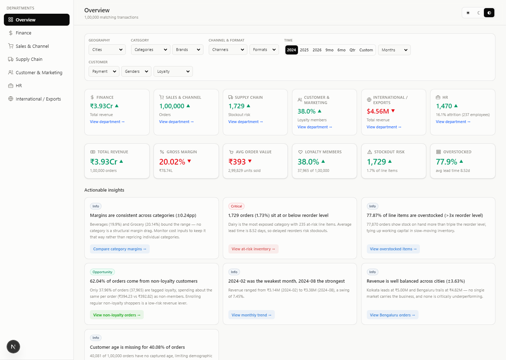
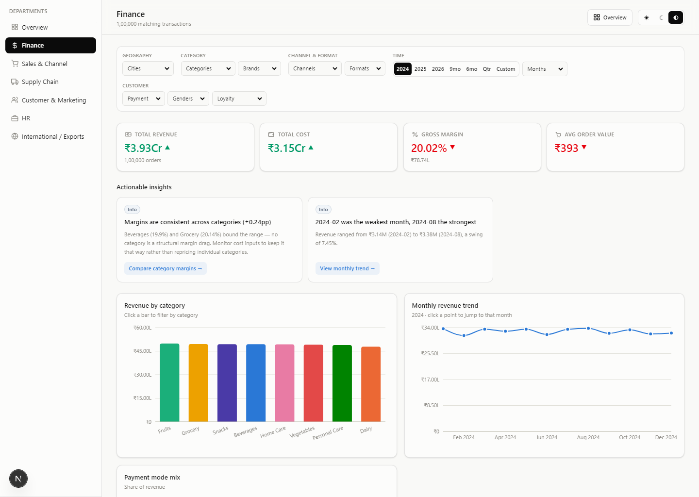
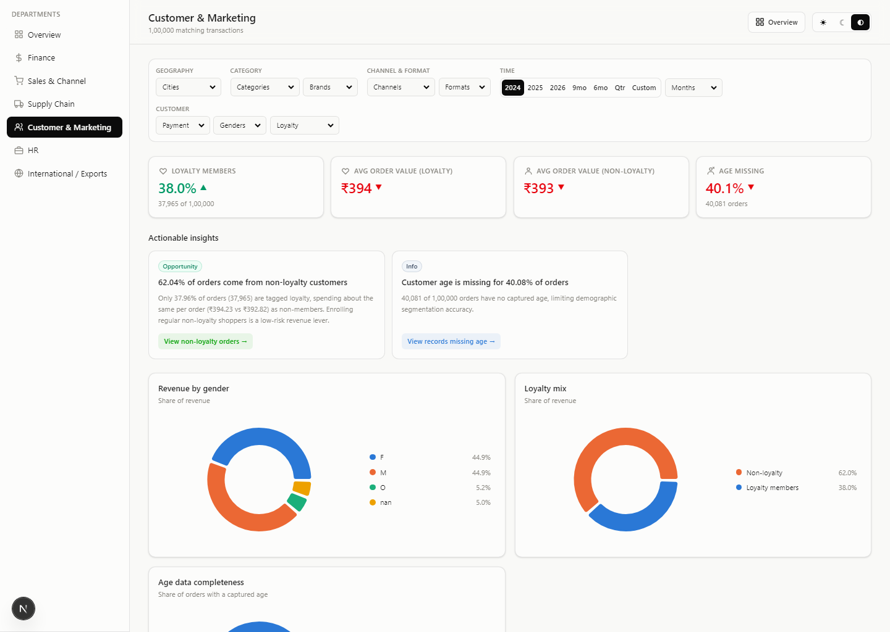
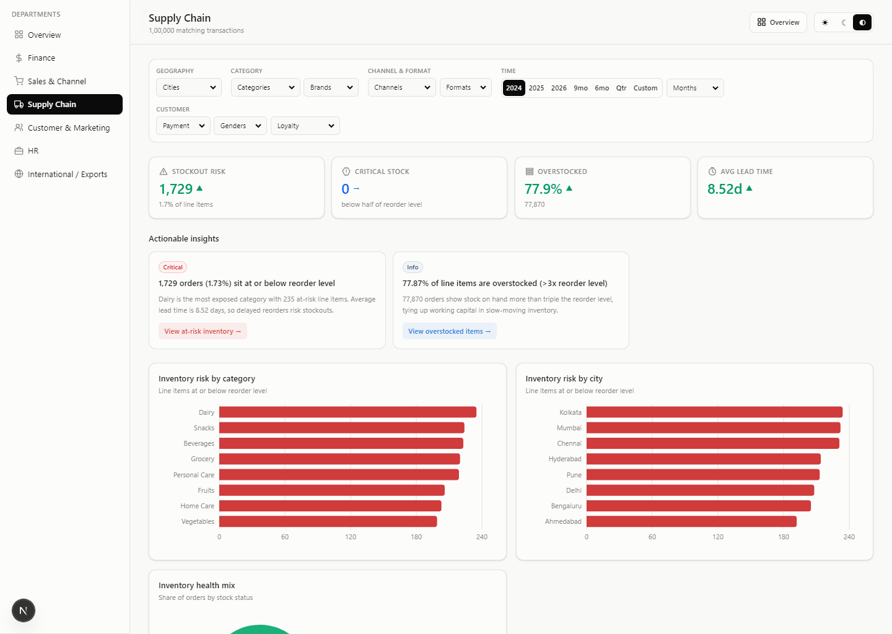
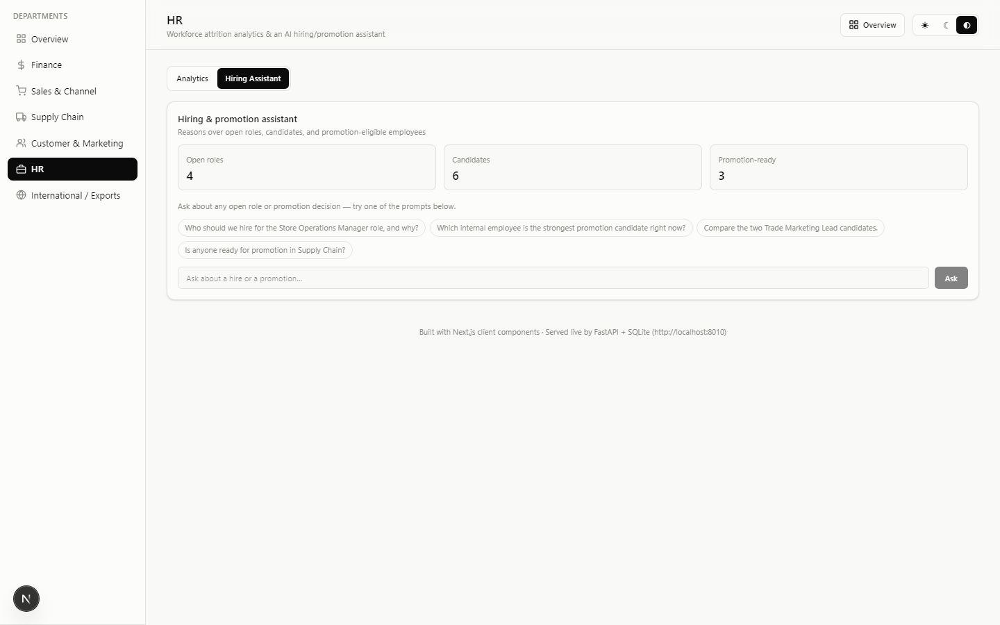

# FMCG Retail Analytics Dashboard

A full-stack analytics dashboard over a 300,000-row synthetic FMCG (fast-moving consumer goods) retail dataset — built end-to-end with a **Next.js** frontend and a **FastAPI + SQLite** backend, covering six business departments plus an AI-powered hiring assistant.

**[Live demo](#)** · *(add your Amplify/EC2 URL here)*



## What's in it

Seven department views, each pulling from the same live backend, with fully cross-filtered charts:

| Department | What it covers |
|---|---|
| **Overview** | Company-wide KPIs and a one-glance summary of every other department |
| **Finance** | Revenue, cost, margin & payment-mode mix |
| **Sales & Channel** | Cities, categories, brands & channels |
| **Supply Chain** | Stock levels, reorder risk & overstock exposure |
| **Customer & Marketing** | Loyalty, gender & age segments |
| **HR** | Workforce attrition analytics **+ an AI hiring/promotion assistant** |
| **International / Exports** | Global transactions by country, generation & payment method (2024–2026, USD) |

### Core features

- **Click-to-filter, everywhere.** Click a bar, a donut slice, or a point on a line chart to filter every other chart, KPI, and the drill-down table on the page. Click the same one again to clear it.
- **Actionable insights.** Each department surfaces a handful of data-driven insights ("62% of orders come from non-loyalty customers"); clicking one applies its filter and jumps straight to the relevant charts.
- **Independent per-department state.** Filters and the year/time-range selector are scoped per department — changing the year on Finance never touches Supply Chain.
- **Drill-down table** with sorting, search, and CSV export of the filtered rows.
- **AI hiring & promotion assistant** (HR tab) — ask natural-language questions about open roles, candidates, and promotion-ready employees; answered by Claude, grounded only in the roster data provided (no invented facts), with prompt caching on the roster payload.
- Light/dark theme, fully responsive charts (Recharts), India (₹) and international (USD) views.

### A few screenshots

<table>
<tr>
<td></td>
<td></td>
</tr>
<tr>
<td></td>
<td></td>
</tr>
</table>

## Tech stack

**Frontend** — Next.js 16 (App Router, Turbopack), TypeScript, Tailwind CSS v4, Recharts
**Backend** — FastAPI, SQLite (stdlib `sqlite3`), Anthropic SDK (hiring assistant)
**Deployment** — AWS Amplify (static frontend export) + EC2 (backend, via `systemd` + `nginx`)

## A couple of engineering details worth calling out

- **Thread-safe SQLite under FastAPI's thread pool.** FastAPI runs sync route handlers in a thread pool, so concurrent requests genuinely execute in parallel. A single shared `sqlite3.Connection` isn't safe to query concurrently even with `check_same_thread=False` — it can silently hand back corrupted (all-NULL) rows under load. Fixed with a `threading.local()`-backed connection, one per pooled worker thread.
- **Response caching keyed on the dataset's own mtime.** `functools.lru_cache` caches aggregate responses by `(db_version(), filters)`, where `db_version()` is the SQLite file's mtime — so any direct edit to the `.db` file invalidates every cache entry automatically, no manual cache-busting needed.
- **Deterministic "dummy" correlations.** Where the dataset needed a believable signal (e.g. loyalty correlating with gender and age), it's derived from a stable column (`invoice_id % 1000`) rather than `RANDOM()`, so the migration script is idempotent and reproducible instead of reshuffling the dataset on every run.

## Project structure

```
fmcg-dashboard/     Next.js frontend
backend/            FastAPI backend
  app/              routes, aggregation queries, hiring assistant
  deploy/           systemd service + nginx config for the EC2 deploy
database/           SQLite database + the scripts that built it
docs/               write-ups, slide deck, and README screenshots
```

## Running it locally

**Backend**

```bash
cd backend
python -m venv venv
./venv/Scripts/activate   # or `source venv/bin/activate` on macOS/Linux
pip install -r requirements.txt
uvicorn app.main:app --port 8000
```

Set `ANTHROPIC_API_KEY` as an environment variable if you want the HR hiring assistant to work; every other department works without it.

**Frontend**

```bash
cd fmcg-dashboard
npm install
npm run dev
```

The frontend expects the API at `http://localhost:8000` by default — override with `NEXT_PUBLIC_API_URL` in a `.env.local` file if your backend runs elsewhere.

## Dataset

`database/fmcg.db` is a synthetic, India-based FMCG dataset — ~300,000 sales records across 8 cities, 2024 (seed data) plus simulated 2025/2026 extensions — alongside a separate international-exports dataset and a synthetic HR attrition dataset. None of it is real company data; it exists to give every chart and insight in this project something realistic to compute over.

## License

MIT — see [LICENSE](LICENSE).
